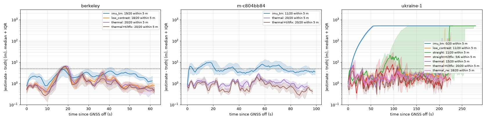

# REPORT - night-demo (Fri 2026-10-23 23:30 -> Sat 07:00)

Agent night-demo: Ukraine mission, route choice, night viewer, final integration + eval. Branch `night-demo` in
`C:\dev\night-demo` (based on origin/v5-mission-planner; merged night-thermal 146a89f and night-nav up to cd6de0e; the eval build is b5409f4 = night-nav 651b398).
Nothing pushed. Commands to continue: `RESUME.md`. Saturday demo script: `DEMO_NIGHT.md`.

## Final eval (night 23:00, 60 m AGL, GNSS completely off from 20 % of the route, 20 seeds)

**Final build (night-demo b5409f4: night route choice + night-nav 651b398 tilt-bias learning): berkeley 20/20,
m-c804bb84 20/20, ukraine-1 20/20 within 5 m of B** (95 % Wilson interval 84-100 % each; mean arrival error
0.4 / 0.9 / 1.9 m, worst 0.9 / 2.0 / 2.5 m). IMU + TRN alone (no thermal): 19/20, 11/20, 0/20.

Harness `demos/30_night_eval.py` (truth-scored): GNSS ok at first, `gnss.mode = off` (no signal at all) when the
TRUE along-route progress passes 20 %; ARRIVAL error = |truth - B| (horizontal) at the moment the drone decides
it is above B (first ABOVE_B / WAIT_FOR_FIX decision); success = arrival error <= 5 m; 95 % Wilson interval.
Flights whose estimate is > 500 m off before arrival are stopped and counted as failures (DIVERGED). Data: a
frozen copy of the three missions taken after night-thermal's final rebuild (01:17; moving traffic on, truth
contrast 0.7), `$SFHACK_DATA/night/demo_eval_snap`. Per-flight JSON (1 Hz error / 2-sigma trace, decisions):
`$SFHACK_DATA/night/eval/<run>/results.json`; combined table + plot: `scripts/night_eval_report.py` ->
`docs/night_eval/`.

Code versions: rows without suffix = night-demo d2405bc (night-nav 4904433 + night-thermal 146a89f + night route);
`thermal_rw` = same + `ekf.acc_bias_rw 0.04` (night-nav's first candidate, they rejected it: flights wobble at
waypoints); `+tiltfix` = night-demo b5409f4 (+ night-nav 651b398: the AHRS learns the roll / pitch gyro bias from
the EKF tilt corrections in night mode; now the default).

| mission | row | n | within 5 m | rate (95 % Wilson) | arrival error mean / median / max (m) | est. error at arrival mean (m) | 2-sigma at arrival mean (m) | thermal fixes accepted / flight |
|---|---|---:|---:|---|---|---:|---:|---:|
| berkeley | thermal | 20 | 20 | 100% [84%, 100%] | 0.8 / 0.7 / 1.8 | 0.5 | 2.5 | 350 |
| berkeley | imu_trn | 20 | 19 | 95% [76%, 99%] | 2.1 / 1.8 / 7.5 | 1.9 | 3.0 | 0 |
| berkeley | low_contrast | 20 | 18 | 90% [70%, 97%] | 39.6 / 0.7 / 566.1 | 11.8 | 7.7 | 309 |
| berkeley | thermal+tiltfix | 20 | 20 | 100% [84%, 100%] | 0.4 / 0.4 / 0.9 | 0.6 | 2.5 | 349 |
| berkeley | low_contrast+tiltfix | 20 | 18 | 90% [70%, 97%] | 19.3 / 0.6 / 225.7 | 19.5 | 2.6 | 312 |
| berkeley | thermal_2hz5+tiltfix | 10 | 10 | 100% [72%, 100%] | 0.6 / 0.7 / 1.0 | 0.6 | 2.5 | 178 |
| m-c804bb84 | thermal | 20 | 20 | 100% [84%, 100%] | 1.3 / 1.3 / 2.3 | 0.8 | 2.5 | 561 |
| m-c804bb84 | imu_trn | 20 | 11 | 55% [34%, 74%] | 68.5 / 4.8 / 565.1 | 18.0 | 9.5 | 0 |
| m-c804bb84 | thermal+tiltfix | 20 | 20 | 100% [84%, 100%] | 0.9 / 0.9 / 2.0 | 0.4 | 2.5 | 564 |
| ukraine-1 | thermal | 20 | 15 | 75% [53%, 89%] | 248.0 / 3.7 / 1662.3 | 4.6 | 2.6 | 962 |
| ukraine-1 | imu_trn | 20 | 0 | 0% [0%, 16%] | 1550.2 / 1586.1 / 1657.8 | nan | nan | 0 |
| ukraine-1 | straight | 20 | 11 | 55% [34%, 74%] | 499.1 / 2.9 / 1534.3 | 1.8 | 2.5 | 739 |
| ukraine-1 | low_contrast | 20 | 11 | 55% [34%, 74%] | 267.5 / 4.6 / 1641.3 | 10.0 | 3.4 | 916 |
| ukraine-1 | thermal_rw | 20 | 18 | 90% [70%, 97%] | 4.0 / 2.8 / 22.3 | 3.7 | 2.6 | 1125 |
| ukraine-1 | thermal+tiltfix | 20 | 20 | 100% [84%, 100%] | 1.9 / 2.1 / 2.5 | 1.6 | 2.5 | 1100 |
| ukraine-1 | straight+tiltfix | 8 | 7 | 88% [53%, 98%] | 51.3 / 0.8 / 403.9 | 1.4 | 2.5 | 883 |
| ukraine-1 | low_contrast+tiltfix | 20 | 19 | 95% [76%, 99%] | 40.0 / 2.1 / 761.6 | 1.7 | 2.5 | 1005 |
| ukraine-1 | thermal_2hz5+tiltfix | 10 | 10 | 100% [72%, 100%] | 2.1 / 2.1 / 2.6 | 1.6 | 2.5 | 540 |

Rows: thermal = thermal localizer (`grad`) + TRN + IMU on the night route (ukraine-1: ROADS, along the road);
imu_trn = no thermal (baseline); straight = thermal on the planner's straight route (ukraine-1: 1129 m without
road in view over the forest); low_contrast = TRUE scene contrast x 0.4 (0.4 x 0.7: ~2.8 K road - grass, a mild
spring / autumn night) while the onboard prior still predicts the hot-day contrast.

Reading it:
- With the final build every flight on all three missions ends within 2.5 m of B.
- Before the tilt fix, ukraine-1 had 3/20 runaways right after GNSS off and two flights at 17 / 25 m (15/20):
  the estimate drifted in the stretches without thermal fixes, then accepted along-track-wrong road fixes
  (overconfident). night-nav found the root cause from these traces (roll / pitch gyro bias, gravity leak).
- **Route choice matters on ukraine-1**: on the straight route over the forest 9/20 flights diverged before the
  fix (11/20 within 5 m) vs 3/20 along the roads (15/20); with the fix straight 7/8 (one runaway at the forest)
  vs roads 20/20. Small samples: suggestive, not conclusive (before the fix: divergences 9 vs 3, Fisher p = 0.08;
  within 5 m 11 vs 15, p = 0.32). When a straight flight survives it is slightly more precise.
- IMU + TRN alone: fine on the short Berkeley leg (450 m blind), 11/20 on the hill, 0/20 on ukraine-1 (every
  flight diverges in calm air; see "What failed").
- **Live-demo speed lever** `--thermal-hz 2.5` (half the thermal frames, half the sim cost): berkeley 10/10,
  ukraine-1 10/10 within 5 m (mean 0.6 / 2.1 m), as good as 5 Hz.
- Mild night (0.4x contrast): final build: berkeley 18/20, ukraine-1 19/20 (before the fix 18/20 and 11/20). Matching is scale-invariant, so most flights hold; the losses are runaways. The two berkeley losses are overconfident (claimed 2-sigma 2.6 m while far off): a mild night needs a contrast-aware fix covariance (next steps).

## What works

1. **Missions outside the US** (`sfhack/missionprep/sentinel.py`, `build.py`): `--region auto` picks NAIP / 3DEP /
   3DEP LiDAR inside the conterminous US, else Sentinel-2 L2A (Earth Search STAC, no account; scene chosen by
   cloud + shadow INSIDE the bbox from the SCL band; only the needed COG tiles read by cached HTTP range requests
   via tifffile, no GDAL; own UTM projection, tested against quadrature) + Copernicus GLO-30 + OSM, synthetic
   point cloud, DSM = DEM + OSM building heights. New layers for every build: `world/osm.json` (raw OSM, for
   the thermal model), `nir.png` + `ndvi.png` (NAIP band 4 in the US, S2 B08/B04 abroad) in world/ and onboard/.
   `--agl` sets the route's minimum cruise height. The US path is unchanged (all old tests green; existing
   missions still count as prepared).
2. **Mission `ukraine-1`**: Skhidnytsia, Carpathian foothills south of Boryslav (V3's S2 area), A 49.2244 N
   23.3220 E -> B 49.2305 N 23.3456 E (25 m from the asphalt main road), 1.8 km, relief 137 m, S2 scene
   2025-08-28 (0 % cloud in the bbox), 41-54 s cold build. Paved / unpaved from OSM `surface`: 3.4 km paved
   (tertiary asphalt), 4.8 km unpaved (tracks), 7.9 km untagged (village lanes, mostly dirt) = 21 / 30 / 49 %.
   Table + figure in docs/MAP_PACKAGE.md ("Outside the US"), `docs/ukraine-1_roads.png`. Day flight on it with
   the RGB vision localizer: ARRIVED 1.06 m.
3. **Route choice** (`sfhack/planning/night_route.py`, onboard): straight while the thermal footprint (56 m at 60 m
   AGL) is expected to hold >= 150 m^2 of paved road, else Dijkstra with a blind-cell cost along the roads, if
   it shortens the longest blind stretch (> 250 m) and costs <= 60 % extra length. ukraine-1: ROADS (straight
   1870 m with a 1129 m blind stretch over the forested hill -> 2034 m along the road, longest blind 64 m);
   berkeley and m-c804bb84: STRAIGHT (longest blind 68 / 101 m). On by default in `FlightSystem(night=True)`.
   Parameters and reasons: docs/NIGHT_DEMO.md.
4. **Night viewer** (`demo_live.py --night`, `demos/liveview/night.py`): dark scene; large white-hot thermal panel
   showing the onboard sensor feed (night-nav's ThermalFrame) with a SEEN vs MAP PRIOR inset of the last match;
   map panel on the predicted night temperature with roads, true / estimated trails, the 2-sigma ellipse and the
   matched roads lit up; HUD with GNSS ON / OFF, nav source (THERMAL + TRN + IMU / INS ...), 2-sigma and true
   error with a 3-minute sparkline. Key N = GNSS completely off / on (no automatic switch). Missing thermal files
   are built on the fly (`ensure_thermal`, ~50 s). Planner page: "Night" checkbox -> `/api/fly {night: true}`.
5. **Eval harness** (`demos/30_night_eval.py`): parallel seeds, GNSS off when the TRUE along-route progress passes
   20 % (simulated operator), arrival error = |truth - B| when the drone decides it is above B, Wilson 95 % CI,
   per-second traces, rows thermal / imu_trn / straight / low_contrast / thermal_rw, frozen mission copy,
   divergence abort, resume + survives a broken process pool (memory pressure). `scripts/night_eval_report.py`
   combines runs into one table + an error-over-time plot that keeps failed flights in the statistics.
   310 scored night flights tonight (34 worker-hours of simulation).
6. **Integration**: night-thermal (thermal model, camera, prior) and night-nav (V3.2 GNSS-free track, TRN, thermal
   localizer, sensor, tilt fix 651b398) merged; my eval traces of the ukraine-1 runaways went to night-nav and led
   to the tilt-bias fix. **Backup videos** (final build) in `$SFHACK_DATA/night/demo/`: `ukraine-1_night_final.mp4`
   (ABOVE B 1.5 m), `berkeley_night_final.mp4`.
7. Tests: new offline tests (global build path, UTM, night route straight vs detour, planner Night pass-through);
   the full suite (75 tests) is green after every merge.

## What failed / limits (honest)

- **IMU + TRN alone diverges on ukraine-1** (0/20; estimate 10 km off after 6 min): closed-loop tilt
  unobservability in calm air (no rotor-drag model in the sim); TRN on the 30 m GLO-30 surface model gets no fix
  accepted once the error is large. The tilt fix (651b398) removes most runaways only together with absolute
  thermal fixes; a blind 30 s stretch (forest on the straight route) can still run away (1/8 with the fix).
- **Mild nights**: at 0.4x contrast 2/20 Berkeley flights run away while claiming a 2-sigma of 2.6 m:
  the fix covariance does not yet scale with the scene contrast (overconfidence).
- **Landing after arrival (not tonight's scope, found while recording)**: berkeley final build, seed 0: ABOVE B at
  0.7 m, then below the thermal localizer's minimum height (10 m) there are no fixes; the drone hovers in LAND and
  the estimate runs away (2-sigma 19.6 m at t = 139 s, estimate error up to 1.7 km later, "landed" 6.7 m from B).
  The pre-fix take landed 1.38 m, ukraine-1 final build 1.43 m. night-nav reproduced it (6.0 m with the fix,
  0.9 m with `night_tilt_bias_ki = 0`, but 5.9 m when only freezing the integral during the descent): the
  velocity error jumps 0.07 -> 0.43 m/s at ~19 m AGL (last thermal fixes during the descent manoeuvre) and nothing
  corrects it below the thermal minimum height. A landing-phase problem (fixes too high, no gating in the
  descent), open in REPORT_night-nav.md. The backup video `berkeley_night_final_trim.mp4` ends during the clean
  descent.
- **Sim speed**: night mode costs ~230 ms per thermal frame (camera render ~97 ms, localizer ~135 ms) and ran at
  ~0.5x real time here (GPU busy with training); the viewer showed 2-3 fps.
- Everything is simulated: thermal world, camera and traffic are night-thermal's model, calibrated to literature
  and night-research's numbers, not to flight data. Hot calm clear night = the favourable case.
- Backup videos are mp4v (no ffmpeg on this machine): play in VLC / browsers; convert if needed.
- Sentinel-2 at 10 m is blurry as the world texture (0.5 m grid); GLO-30 is a DSM, so the "terrain" of
  ukraine-1 contains the forest canopy shape; 346 of 348 buildings use the default 10 m height.
- The preliminary run1 (01:00) was stopped because night-thermal rebuilt the thermal files mid-run; the final
  eval runs on a frozen copy (`$SFHACK_DATA/night/demo_eval_snap`). My `taskkill /T` to stop it probably also
  killed some of night-nav's eval workers (Windows parent-PID reuse); apologised, used explicit PIDs afterwards.
- Windows commit charge ran out (~1.7 GB free of 81 GB) with 27 sim workers across agents: pools broke; fixed by
  agreeing on worker caps (night-nav 9, night-demo 6-8) and making both harnesses resumable.

## Next steps

- Saturday: landing at B at night: thermal fixes stop below 10 m; check whether the gyro-bias integral keeps
  acting in the low hover without fixes (night-nav's suggestion: `cfg.thermal.night_tilt_bias_ki = 0` for the final
  descent restores the pre-fix behaviour that landed 1.4 m), use the rangefinder + last fix for the flare.
- Rotor-drag model + drag-velocity fusion (as in death-v3) so blind stretches do not run away.
- Route choice: weight by thermal localizability (prior gradient energy) instead of road area only; add
  junction density; show the night route on the planner page.
- Weather: clouds / wind reduce contrast; tie `thermal_contrast` to a weather lever.
- Thermal fix covariance that grows with low scene contrast / low match quality (the mild-night runaways).
- Viewer speed: render the thermal frame once per sensor tick and reuse it for the panel (already), move the
  localizer off the display thread, or lower the camera rate in the viewer only.

## Disclosure (all of this is PRE-HACKATHON work, built Fri 23:30 - Sat 07:00 by Claude Code agents)

Built by night-demo tonight: Sentinel-2 / GLO-30 global mission path (sentinel.py, region switch, NIR / NDVI,
osm.json, --agl), mission ukraine-1, scripts/plot_mission_roads.py, night route choice (night_route.py + the
extra-cost hook in plan_route), the night viewer (liveview/night.py, demo_live --night, key N, ensure_thermal),
planner Night checkbox, eval harness demos/30_night_eval.py + scripts/night_eval_report.py, docs (NIGHT_DEMO.md,
MAP_PACKAGE.md section, DEMO_NIGHT.md, README section, docs/night_eval/), the merges, the final eval (310
simulated night flights) and the backup videos. Data added to $SFHACK_DATA (nothing existing modified except my
own new mission ukraine-1): missions/ukraine-1, thermal files for campus-glade (via ensure_thermal),
night/demo_eval_snap, night/eval/*, night/demo/*. Merged from the other night agents (also
pre-hackathon): night-thermal (thermal world model, thermal camera, prior), night-nav (V3.2 GNSS-free track,
TRN, thermal localizer, thermal sensor), night-research (facts used in DEMO_NIGHT.md).
