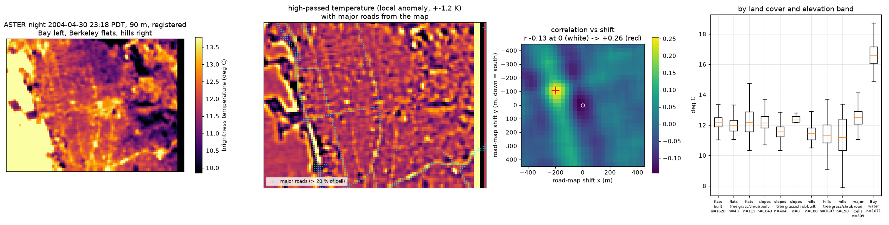

# Night research: thermal navigation without GNSS (pre-hackathon, 2026-10-23/24)

Agent night-research. This is the long version, written for the morning read. The short numbers the other
agents need are in [NIGHT_NOTES_FOR_TEAM.md](NIGHT_NOTES_FOR_TEAM.md). Scripts and figures live in
[docs/night_research/](night_research/).

Scenario (NIGHT_PLAN.md): summer night, 23:00, clear, no wind, after a hot day. The drone flies A -> B at 60 m AGL;
GNSS disappears completely; it continues on IMU, barometer, rangefinder, TRN on the onboard DSM, and a downward
640 x 512, ~50 deg thermal camera. From daytime imagery we predict what stays warm at night (asphalt above all)
and match the live thermal image against that prediction.

**Bottom line**
- The premise holds, with corrections:
  - **Asphalt is the warmest common surface at night**, about 4-8 K above the air at 23:00.
  - **Grass is the coldest**, about 2-5 K below the air.
  - The asphalt-grass contrast is **5-10 K after a hot clear day** (model + field measurements). That is
    100-200 times the camera noise (NETD). On mild nights it can be only ~1-3 K (section 6).
- Corrections to the plan's assumptions:
  - **Water is warm, not cool.**
  - **Trees are warmer than lawns.**
  - **Insulated roofs are cold**, not warm. Only heavy concrete roofs stay warm.
  - **Unpaved roads are unreliable.**
- Real night thermal satellite scenes over Berkeley (ASTER, 23:13-23:18 PDT, 90 m, 4 clear nights; section 6)
  confirm the signs:
  - road corridors are the warm linear features;
  - the Bay is +3.5-5.2 K warmer than land;
  - correlating the night image with the road map recovers a 230 m geolocation error of the satellite scene,
    which is our method in miniature.
  But the contrast is small at 90 m (+0.2-0.7 K for road-dense cells). That implies only ~1-3 K pure road
  contrast on those mild spring / autumn nights. **Test the system at reduced contrast too.**
- Fielded camera-to-map navigation reaches ~10-30 m (vendor claims). The only public night-thermal flight
  with a number is < 15 m RMS. Our 5 m target is feasible in simulation only because we fly low (8.7 cm/px)
  over mapped roads; it is ambitious for real life.
- Recommended matcher for a one-day build:
  - dense gradient-orientation correlation (polarity-free) against the predicted raster;
  - normalized mutual information as a verifier;
  - a 1-D fix on single straight roads.
  No learned models are needed.

Contents: 1 Physics | 2 Real systems | 3 Matching methods | 4 Ukraine | 5 Camera sanity check |
6 Validation with a real night scene | 7 Pitch | Disclosure | Sources

---

## 1. Physics: why asphalt stays warm at night

### 1.1 Mechanism

A surface's temperature follows its energy balance:
`absorbed sun + absorbed sky longwave = emitted longwave + convection to air + evaporation + conduction into the ground`.
After sunset the sun term vanishes. On a clear night the sky radiates like a body ~20-30 K colder than the air
(clear-sky emissivity ~0.75-0.8, Brutsaert 1975 [P1]). So every surface loses roughly 60-100 W/m^2 net longwave,
and what it can draw from storage decides how cold it gets.

- **Asphalt:**
  - Low albedo (0.05 new to ~0.15-0.2 aged [P2]), so it absorbs 80-95 % of the sunlight.
  - High thermal inertia, `P = sqrt(k rho c)`, of ~1600 J m^-2 K^-1 s^-1/2 (k ~ 1.2 W/m K, rho c ~ 2.1 MJ/m^3 K).
  - The daily heat wave penetrates a damping depth `sqrt(2 kappa / omega)` of ~12 cm.
  - It therefore stores a large amount of heat during the day and conducts it back to the surface all night.
  - Asaeda et al. (1996) measured asphalt releasing, at the maximum, an extra 150 W/m^2 of infrared and 200 W/m^2
    of sensible heat compared with bare soil [P3]. Asphalt stores and re-emits more heat than concrete or bare soil.
  - EPA's cool-pavements compendium: conventional pavements store heat in the subsurface and release it at night,
    driving the nighttime urban heat island [P4].
- **Concrete:** similar thermal inertia but higher albedo (0.25-0.35), so less stored heat. At night it runs
  1-2 K below asphalt. Asphalt surface temperatures are consistently higher than concrete [P5].
- **Grass / lawn:**
  - The radiating surface is a layer of thin blades with almost no heat capacity.
  - It is insulated from the soil by the air-filled canopy, and it spends its daytime energy on evapotranspiration.
  - On clear, calm nights it cools well below the air. The grass-minimum thermometer typically reads ~4-6 K below
    the screen air temperature (Parana, Brazil, average 5 K [P6]).
  - This is the reason "grass frost" forms while the air stays above 0 C [P7].
- **Trees:**
  - Leaves have no storage but are well coupled to the air (small leaves, both sides ventilated).
  - Inner leaves see other leaves, not the sky.
  - The canopy top therefore stays within ~0-2 K of the air: cooler than surroundings by day, **warmer than open
    grass at night** [P8].
- **Water:**
  - Sunlight penetrates metres deep and mixing spreads the heat, so the diurnal amplitude is only ~1-2 K.
  - At night the water surface sits near the daily-mean temperature, warmer than land. "The LST of water bodies
    at night is higher than that of the land masses" [P9].
- **Roofs** depend on construction:
  - **Light-weight roofs over insulation** (shingles, membranes) have no heat store under the skin and radiate
    to the sky. They run several K **below** the air at night: up to ~11 K below ambient for membranes over
    insulation (NBS/NIST [P10]). The NRCA field tests also found membranes cooling below ambient [P11].
  - **Heavy roofs** (concrete slab, gravel ballast) behave like pavement.
  - **Bare metal** has a low emissivity (0.2-0.6 [P12]), so a thermal camera mostly sees the reflected cold sky.
    "Unpainted metal roofs have a very low emissivity, causing extremely low gray values in thermal images" [P13].
- **Dirt and gravel roads:** compacted dry earth sits thermally between asphalt and loose soil, and moisture
  changes everything (the thermal inertia of soil rises ~5x from dry to wet [U18]). NASA airborne thermal
  surveys: "roads surfaced with blacktop ... are generally light (warm), while most graded gravel and dirt roads
  are not recorded on the image, but a few are moderately dark (cool)" [P13]. **Do not count on them.**

### 1.2 Typical apparent temperatures at 21 / 23 / 03 h

The literature has many daytime pavement studies and few night-time absolute values. So I wrote a small 1-D surface
energy balance model ([surface_energy_balance.py](night_research/surface_energy_balance.py)): layered columns with
literature material properties, clear-sky sun, Brutsaert sky longwave, convection, evaporation for vegetation,
run to a periodic state. I checked it against the measured anchors below. "Apparent" = what an 8-14 um camera reads
with emissivity 1, i.e. emitted plus reflected sky.

Forcing (clear sky, calm night, 15 July):
- Berkeley: hot July day 28 / 14 C, dew point 11 C.
- Central Ukraine: hot July day 30 / 16 C, dew point 14 C.

Clock time for both: PDT / EEST, solar noon ~13:15.

| Surface | Berkeley 21 h | 23 h | 03 h | Ukraine 21 h | 23 h | 03 h |
|---|---|---|---|---|---|---|
| air (2 m) | 22.0 | 18.7 | 15.2 | 25.3 | 21.1 | 17.1 |
| asphalt road / parking | **30.0** | **25.6** | **19.9** | **31.9** | **28.0** | **22.2** |
| concrete pavement | 27.5 | 24.0 | 19.2 | 29.7 | 26.5 | 21.6 |
| heavy roof (gravel on concrete) | 26.5 | 23.3 | 19.0 | 28.7 | 25.8 | 21.2 |
| gravel / dirt road | 24.5 | 20.2 | 15.1 | 27.2 | 23.0 | 17.6 |
| trees (canopy top) | 20.2 | 16.9 | 13.5 | 23.6 | 19.5 | 15.5 |
| water (SF Bay ~17 C / pond ~24 C bulk) | 16.5 | 16.5 | 16.5 | 23.8 | 23.5 | 23.4 |
| bare soil, dry | 20.9 | 16.5 | 12.0 | 24.3 | 19.6 | 14.6 |
| grass, irrigated lawn | 18.6 | 15.8 | 12.7 | 22.6 | 18.8 | 15.3 |
| grass, dry (summer) | 19.1 | 15.8 | 12.1 | 23.0 | 18.8 | 14.6 |
| light roof over insulation (dark or white) | 15.3 | 11.3 | 7.9 | 20.4 | 14.6 | 10.5 |
| bare metal roof (emissivity 0.25) | 9.0 | 5.9 | 2.7 | 13.9 | 9.7 | 5.9 |

Model figures: [seb_diurnal_berkeley.png](night_research/seb_diurnal_berkeley.png),
[seb_diurnal_ukraine.png](night_research/seb_diurnal_ukraine.png).

Checks against measurements:
- **Asphalt - grass at night.**
  - Erzurum, Turkey, 15 clear calm August days, contact sensors: asphalt was the warmest surface all day; the
    asphalt-grass difference was 23 K at 13:00 and smallest at 22:00 with **5.4 K** [P14].
  - Midnight UAV survey: paved roads +2.3 K and grass -2.5 K relative to the scene mean, i.e. ~4.7 K apart [P15].
  - Ghent heatwave drone survey: at 23:00 pavement had cooled by ~30 K from the day but stayed warmer than
    grass (~20 C) [P16].
  - UAV evening survey (20:30): asphalt 33.3 C, water 29.6 C, grass 25.9 C [S-RS].
  - **My model gives 9.8 K** at 23 h (Berkeley) and 9.2 K (Ukraine), i.e. on the high side of the measurements.
  - **Team range: 5-10 K.**
- **Grass below air:** model 3 K at 23 h, measured typical 4-6 K at the night minimum [P6]. Consistent.
- **Daytime peaks:** model asphalt 55-58 C and lawn 37 C vs measured asphalt ~57 C and lawn ~40 C maximum in a
  Paris schoolyard study [P17]. Consistent.
- **Insulated roofs below air:** model -7 K, measured up to -11 K [P10]. Consistent.

Model limitations:
- No anthropogenic heat and no traffic.
- No sky-view reduction in street canyons (canyons cool slower, which raises road temperatures).
- No dew.
- Simple air-temperature curve and fixed convective coefficients (calm night h = 5 W/m^2 K).
- Water bulk temperatures are set by hand.

### 1.3 Contrast over the night and thermal crossover

Thermal crossover = the times when two materials have the same apparent temperature and their contrast vanishes
[P18]. It happens around sunrise and sunset, when the sun term switches.

| | 21 h | 23 h | 03 h | crossover |
|---|---|---|---|---|
| asphalt - lawn (Berkeley, model) | 11.4 K | 9.8 K | 7.2 K | none (minimum 2.1 K ~1 h after sunrise) |
| asphalt - trees | 9.8 K | 8.7 K | 6.4 K | none (minimum 2.9 K) |
| asphalt - dirt road | 5.5 K | 5.4 K | 4.8 K | none (minimum 0.9 K) |
| asphalt - water (Ukraine pond 24 C) | 8.1 K | 4.5 K | -1.2 K | **~01:50 and ~07:40**: the pond becomes warmer than asphalt late at night |
| trees vs lawn, soil vs grass | | | | around sunset / sunrise (Erzurum: soil = grass at 19:00 [P14]) |

So **23:00 (~2.5 h after sunset) is in the stable night regime.** The road contrast is lower than at 21 h but still
large, and it keeps decaying slowly until dawn. The worst time for road-vs-vegetation matching is the morning
transition (~1-2 h after sunrise), not the night.

### 1.4 Clouds, wind, rain (not in tonight's scenario, but the jury will ask)

All runs are Berkeley at 23 h with the energy balance model.

| Condition | asphalt | lawn | asphalt - lawn | Comment |
|---|---|---|---|---|
| clear, calm (base) | 25.6 | 15.8 | 9.8 K | |
| clear, breeze ~3 m/s (h = 14 W/m^2 K) | 23.2 | 16.8 | **6.4 K** | wind couples every surface to the air; cuts the contrast by about a third |
| half cloud after a sunny day | 27.6 | 18.4 | 9.2 K | |
| overcast after a sunny day | 29.6 | 21.0 | 8.6 K | clouds stop the radiative loss; everything stays warmer, contrast survives |
| overcast all day and night | - | - | small (est. 1-3 K) | little heat was stored; not modelled |
| rain | - | - | ~0-2 K | wet surfaces tend toward the wet-bulb temperature; evaporation dominates; contrast collapses for hours |

Source for the wind effect on grass cooling: calm clear nights give the largest gaps [P7]. ERA5 for central
Ukraine in July puts 65-75 % of 23:00 hours calm (<= 10 km/h), but only 31-38 % clear and 28-36 % overcast (U-section
below). **Clear and calm is the best case, not the typical case.**

---

## 2. Real systems: how drones navigate at night without GNSS

Full table with 22 entries and URLs: section A of the agent notes, summarized here. Nearly all numbers are
**vendor claims**; independent test data is rare.

| System | Who | Sensor / method | Reported accuracy | Night? |
|---|---|---|---|---|
| Raptor Guide + Inertial Labs VINS | Maxar (Vantor) / Inertial Labs | camera frames vs 3D terrain model, 1 Hz fixes into INS | Raptor "< 10 m RMSE"; **night flight, FLIR Boson+, Cessna, ~58 km: < 15 m RMS** [S1]; 18 flights: mean 16.6 m, IR 15.9 m vs day 18.1 m [S2] | **yes** |
| Vision Aided Navigation | Honeywell | real-time image correlation vs onboard reference maps, visible or IR | 10 m CEP50 (Embraer demo) [S3] | IR claimed |
| TERCOM + DSMAC | US Navy (Tomahawk) | radar altimeter vs DEM; nadir image vs reference scene (FFT correlation) | ~80 m / ~10 m CEP (secondary sources) [S4] | DSMAC used a strobe |
| VNav | Palantir (Red Cat Black Widow) | downward view vs onboard satellite imagery + INS | n/r; flown down to 150 ft AGL [S5] | n/r |
| VPS | Vermeer (US/Ukraine) | up to 4 EO/IR cameras, AI matching to 2D/3D maps | n/r [S6] | training data includes night |
| Receptor AI (Vector) | Quantum Systems | "infrared-supported visual navigation" | n/r [S7] | day and night claimed |
| HX-2 / Altra | Helsing | terrain features vs stored maps | n/r; field results disputed [S8] | n/r |
| VNS01 | UAV Navigation (ES) | VO + map matching (roads, rivers, coastlines) + altimeter TRN | ~30 m "regardless of distance" [S9] | n/r |
| OSCAR | Twist Robotics (UA) | landmark recognition vs map | "20 m" [S10] | day, night, fog claimed |
| Eagle Eyes, Perun, Salamandra | Ukrainian makers | live video vs onboard map | Perun "~5 %" [S11] | IR being added |
| Ghost Dragon nav | KrattWorks (EE) | NN landmark views vs map, re-localizes on crossroads [S12] | n/r | n/r |
| "Susanin" | Russia (Geran-4/5, per HUR) | electro-optical correlation vs stored images [S13] | n/r | n/r |
| NightSense | Skydio | VIO with active IR / visible illuminators (not map matching) [S14] | n/r | yes, active light |

Research on thermal-to-satellite geo-localization:
- NYU ARPL (Xiao, Loianno) flew a **Boson 640 with a 50 deg HFOV at night** (21:00-04:00), at ~1 m/px over
  desert:
  - retrieval: 14.7 m [S15];
  - STHN deep homography: 12.1 m [S16];
  - UASTHN: ~7 m [S17].
- SCC-Loc (2026), training-free (DINOv2 + MINIMA-RoMa): mean 9.4 m, 52 % within 5 m [S18].
- Thermal-inertial odometry (Khattak; TP-TIO; DeepTIO; KAIST; JPL) is real but shown mostly indoors, in mines and
  in smoke. I found no outdoor night drift-% figure [S19]. An edge-based thermal odometry on a ground robot
  worked **better at night than by day** [S20].
- Road / junction matching to OSM (RGB, 1 m/px): intersections within 2.5 m in >= 90 % of cases [S21].
- Two direct precedents for "predict a reference from day data":
  - ECOSTRESS night georeferencing built its reference from a Sentinel-2 water mask plus Canny edges: error
    14.9 -> 2.9 px [P9];
  - Landsat thermal matched against a land-cover map: 72 % within 1 px [S22].

Ukraine context:
- EW makes GNSS unusable near the front.
- Ukrainian makers call optical navigation a "must-have" beyond ~20 km range and are adding IR cameras for
  night [S11].
- Russia fields the same idea [S13].
- Almost none of this comes with independent accuracy data.

**Takeaways:**
- (a) Absolute fixes at ~1 Hz into an INS filter is the standard architecture. It is what we have.
- (b) Fielded systems quote 10-30 m from 150 ft to 2 km AGL with ~1 m/px maps. We fly at 60 m with 8.7 cm/px
  frames against a 0.5 m/px prior, so metre-level fixes are plausible in simulation.
- (c) The one documented night thermal flight matched against **3D structure**, not predicted radiometry. This
  is a hint to lean on geometry (edges, roads, DSM) more than on absolute temperatures.

---

## 3. Methods: matching a thermal image to a daytime map

Setting: the frame is ortho-rectified with AHRS attitude and EKF / rangefinder height (as the RGB `map_localizer`
already does), so the remaining problem is mainly a 2-D shift inside the EKF 3-sigma window.

| Method | How | Pros | Cons | CPU cost | One-day fit |
|---|---|---|---|---|---|
| **Gradient-orientation correlation** (CFOG / HOG-like channels, mod 180 deg) [M1] | per-pixel oriented-gradient channels of the thermal frame and of the predicted raster (or the ortho), NCC via FFT / `cv2.matchTemplate` | no training; **polarity-free** (roofs and trees whose sign we cannot predict still match by their edges); drops into the existing pipeline | needs shared edges; thermal edges are blurred; thermal-only edges (cars, afternoon shadows) | ms-tens of ms | **best** |
| Phase congruency (HOPC, RIFT) [M2] | contrast-invariant structure | beats NCC/MI on multi-modal remote sensing | heavier (log-Gabor banks); RIFT failed on a UAV thermal-visible benchmark [M3] | 100s ms | ok |
| **Normalized mutual information** vs a class map [M4] | maximize the statistical dependence between the thermal frame and the predicted class raster | needs no temperature model, only distinct classes; handles unknown gain and polarity | flat, multi-modal cost with few classes in a 56 m frame; histogram binning | tens-100s ms (downsampled) | **good as verifier** |
| **Road centreline + junctions** [S21] | threshold / ridge-filter warm pixels, skeletonize, Chamfer-match to OSM roads with width; junction graph for global re-localization | uses exactly what is reliable at night; OSM vectors are precise | 0-2 junctions per frame; **a straight road fixes only the cross-track position**; parking lots are blobs | ms | good component |
| Learned cross-modal (XoFTR [M5], MINIMA [M6], RoMa [M7], STHN [S16]) | pretrained transformer matchers thermal <-> visible | best published robustness | GPU-class; seconds per frame on CPU; trained at ~1 m/px or street level; needs torch + weights | s | benchmark only |
| Classical segmentation -> label matching | quantile classes of the thermal frame vs predicted classes | modality-free | in classical form it is MI in disguise | ms | via NMI |

**Recommendation for tomorrow:**
1. Predict a thermal raster at 0.5 m/px:
   - paved roads and parking (OSM with width, paved surface only) warm;
   - lawn and open vegetation (NDVI high, no DSM height) cold;
   - tree canopy (NDVI high, DSM height) mild;
   - water warm;
   - roofs as **edges with unknown sign** (or large sigma).
   night-thermal is building this.
2. Primary matcher: dense gradient-orientation correlation in the 3-sigma window, with the existing gates
   (score, second peak, uniform template, window too wide).
3. Verifier: NMI against the class raster at the top-k peaks. Accept only if they agree within ~1 m.
4. Straight-road degeneracy: if the structure tensor of the template is strongly anisotropic, send a **1-D fix**
   (along-road variance inflated) instead of a 2-D fix.
5. Keep DSM-TRN as the consistency check over buildings, and as a veto against wrong peaks.
6. Skip learned matchers in the loop.

---

## 4. Ukraine

Full notes with every URL: agent notes in the scratchpad, summarized here.

### 4.1 Open data without an account
- **Sentinel-2 L2A** (10 m B2/B3/B4/**B8 NIR**, 5-day revisit with 2 satellites) on Earth Search
  (`https://earth-search.aws.element84.com/v1`, collections `sentinel-2-l2a` and `sentinel-2-c1-l2a`) [U1, U2].
  - **Gotcha (BOA offset):** processing baseline >= 04.00 stores DN = reflectance x 10000 + 1000.
    - Earth Search items with `earthsearch:boa_offset_applied: true` have the 1000 **already removed**, even
      though their `raster:bands` still list offset -0.1. Applying it again zeroes red and pushes NDVI to ~1
      (found by night-demo on S2C_34UFV_20250828).
    - Rule: offset 0 when `boa_offset_applied` is true, else reflectance = DN x 1e-4 - 0.1.
  - In July a Vinnytsia box had 18 scenes per month, cloud cover 0-100 %; pick by cloud cover.
  - License: free and open, credit "Copernicus Sentinel data [year]".
- **Copernicus GLO-30** [U3]:
  - **a DSM** (buildings, trees, tree belts included), not a DTM;
  - < 4 m LE90 vertical, < 6 m CE90 horizontal;
  - public in `s3://copernicus-dem-30m` (verified for Ukrainian tiles) and on Earth Search as `cop-dem-glo-30`.
- **ESA WorldCover** 10 m (CC BY 4.0, ~75 % overall accuracy) for tree / crop / built masks [U4].
- **Microsoft building footprints** cover Ukraine (288 tiles) [U5]. Google Open Buildings does **not** [U6].
- **Landsat thermal**: 100 m native, and L2 surface temperature exists only for daytime scenes [U7], so it is no
  night reference.

### 4.2 Roads: paved vs unpaved
- Official (2015) [U8]:
  - 169,647 km of public roads, 97.9 % "hard surface";
  - "hard surface" **includes ~25,000 km of chipping / gravel**; asphalt + concrete + bituminous is ~77-78 %.
  - Field and agricultural tracks are not in these statistics.
- OSM, whole country, by way count (Geofabrik taginfo, 2026-10-23) [U9]:
  - only **22 % of highway ways carry `surface`**;
  - tagged trunk / primary / secondary: 98-99.5 % paved; tertiary 88 %;
  - tagged **residential: 58 % unpaved**; track: 98.8 % unpaved, and track is the largest class (630k ways).
- Three rural sample boxes (~120 km^2 each near Vinnytsia, Ternopil, Ivano-Frankivsk; Overpass, km) [U10]:
  - **46-70 % of mapped road km is `track`**;
  - only **~7-12 % is known or likely asphalt**;
  - some `secondary` roads are tagged gravel.
- War damage: > 25,000 km of roads and 344 bridges damaged or destroyed nationally; no oblast breakdown found
  [U11].
- **Rule for the prior**, from the shares above:
  - warm = `surface` in {asphalt, concrete, concrete:plates, paved, paving_stones, sett};
  - also warm = no tag AND highway in {motorway, trunk, primary, secondary};
  - tertiary untagged: 0.88 confidence;
  - residential / unclassified untagged: ~0.4;
  - service: ~0.65;
  - track: not warm.

### 4.3 Summer climate (central / western Ukraine)
- July normals 1991-2020 [U12]:
  - mean max 24.7-25.8 C, mean min 13.7-14.8 C;
  - 73-97 mm of rain on ~10-16 days (convective);
  - relative humidity 70-74 %.
- ERA5 at 23:00 in July, 2015-2024 (Open-Meteo) [U13]:
  - air 18.6-19.2 C, dew point ~14 C, wind ~9 km/h;
  - **calm on 65-75 % of nights, clear on only 31-38 %, overcast on 28-36 %**;
  - late-evening rain on 8-15 % of nights;
  - August is clearer (39-55 %).
  - ERA5 runs ~2-3 K too warm at night vs stations.
- Darkness:
  - sunset 20:47-21:35 EEST (late June-July), civil dusk ~21:47 (Vinnytsia, 15 July) [U14];
  - 23:00 is fully dark;
  - the usable night window is ~22:30-04:30.

### 4.4 Implications
1. Only a sparse warm skeleton exists in rural Ukraine: 1-3 asphalt through-roads per 10 km box, plus village main
   streets. **Route along them** (night-demo's route choice), since straight lines over fields see mostly cold
   tracks.
2. Shelterbelts (~440,000 ha nationally [U15]; 48,599 OSM `tree_row` ways) are long, mild-warm linear features. They
   are good landmarks (WorldCover tree class, DSM ridge) but can be confused with roads.
3. The July harvest changes the field mosaic weekly (standing crop -> stubble -> tilled soil) [U16, U17]. Do not
   rely on field patterns from an old Sentinel-2 scene.
4. Village roofs: many are metal or asbestos-cement sheets. Metal looks cold (low emissivity). Use them as edges,
   not as "warm".
5. Valleys pool cold air on calm nights. Expect the same material to look 1-3 K colder in a valley than on a slope.

---

## 5. Sanity check of our assumptions

| Quantity | Value | Note |
|---|---|---|
| Sensor | FLIR Boson 640: 640 x 512, 12 um, 8-14 um [C1] | the obvious real part |
| HFOV 50 deg | Boson 8.7 mm (9.2 mm compact) lens [C1] | VFOV = 2 atan(tan 25 deg x 512/640) = **40.9 deg** |
| Footprint at 60 m AGL | **56.0 m x 44.7 m** | 2 x 60 x tan 25 deg; at 30 m: 28 x 22 m |
| Ground sample distance | **8.7 cm/px**, IFOV 1.36 mrad | our prior is 0.5 m/px: downsample the frame ~6x before matching |
| NETD | Boson <= 40 mK (industrial), <= 50 (professional), <= 60 (consumer) [C1] | **50 mK is right** |
| Scene contrast / NETD | 5-10 K / 0.05 K = **100-200** | noise is irrelevant; prior-vs-reality mismatch dominates |
| Absolute accuracy | uncooled: typ. +-5 K or 5 % (general datasheet figure) | **match normalized images, never Kelvin** |
| Frame rate | 60 Hz baseline, 30 Hz selectable, 9 Hz variant [C1] | we use ~5 Hz |
| Latency | < 25 ms with AGC [C1] | |
| Motion blur | bolometer time constant ~10 ms x 8 m/s = ~8 cm = 1 px | negligible |
| Atmospheric path, 60 m | << 0.5 K | ignore |
| Road width in pixels | 9-12 m residential street = 100-140 px; 1.5 m sidewalk = 17 px | |
| Rectification error | 1 deg attitude error x 60 m = 1.05 m | larger than the matcher error; AHRS tilt matters |
| Emissivity | asphalt 0.95, concrete 0.92-0.97, grass 0.98, water 0.98-0.99, black / white rubber roofing 0.91 / 0.97, metal roof 0.2-0.6 [P12] | |

Verdict:
- The geometry is good: a 56 m footprint holds 1-2 street widths in a city.
- Over parks, campus lawns and big roofs some frames will contain **no road at all**. The localizer must then
  return None, not force a fix.
- In rural Ukraine, frames between asphalt roads see only fields and tracks.

---

## 6. Validation with a real night thermal scene over Berkeley

**Data (open, no account):**
- **ASTER L1T** night scenes (Terra, TIR band 13 at 10.6 um, 90 m) from the Microsoft Planetary Computer STAC
  (`aster-l1t`). The night overpass is at **23:12-23:18 PDT**, i.e. our scenario hour.
- ESA WorldCover 2021 (10 m) land cover, Copernicus GLO-30 elevation.
- Road centrelines from Overture Maps (2026-10-21 release, OSM-derived). Overpass was unreachable from this
  machine all night.

Scripts: [aster_night_check.py](night_research/aster_night_check.py) (download, per-scene stats, contact sheet),
then [aster_night_analyze.py](night_research/aster_night_analyze.py) (registration and statistics). Full tables:
[aster_night_summary.md](night_research/aster_night_summary.md).

ECOSTRESS (70 m, recent, many summer nights) and Landsat (night scenes are Level-1 only) both need an Earthdata or
USGS / AWS account. I skipped them; the steps are in REPORT_night-research.md.

**Scenes:**
- 11 night scenes over the box (2002-2006). By eye ([contact sheet](night_research/aster_night_contact_sheet.png)):
  - 4 clear: 2004-04-30, 2004-04-07, 2003-10-30, and 2003-10-21 (with a strong inversion);
  - 5 cloud or fog;
  - 1 doubtful;
  - 1 covering only the hills.
- **No clear June-August night scene exists.** Summer nights in Berkeley are mostly under the marine layer, which
  is itself a finding. The clear nights followed mild spring / autumn days, not the hot day of our scenario.

**Results (4 clear nights, 23:13-23:18 PDT):**

1. **Matching the night image to a road prior works, even at 90 m.**
   - The delivered night geolocation is off by **~230 m** (image shifted +200 m east, -110 m south).
   - Correlating the high-passed night temperature with the high-passed road share over shifts of +-450 m finds
     the offset: **r = -0.13 as delivered -> +0.26 registered** (per scene +0.10 to +0.29).
   - The correlation surface is a **north-south ridge**: Berkeley's north-south arterials constrain east-west
     well and north-south weakly. That is the along-road degeneracy we expect in flight (section 3, point 4).
2. **Roads are warmer at night, but the 90 m signal is small:**
   - cells with >= 35 % road are **+0.14 to +0.70 K** warmer than cells with < 5 % road;
   - major-road corridors are **+0.17 to +0.53 K** warmer than low-road cells (n = 309 vs 1778);
   - on the regression's per-100 % scale, major roads stand out by +0.7 to +1.6 K over minor roads.
3. **Land-cover classes within the same elevation band differ by less than ~1 K.** Built-up vs tree vs grass
   at 90 m mixes warm roads with cold roofs and yards (section 1.1), and the classes largely cancel.
4. **Water is clearly warm: +3.5 to +5.2 K** over the land flats on every clear night. This confirms the
   correction in section 1.
5. **Terrain matters as much as cover.** On the inversion night the hills are warm, +1.4 K per 100 m of
   elevation; on the other nights -0.04 to -0.25 K per 100 m. Cold-air drainage and inversions are a real
   "unmodelled" signal.

**What it means for us:**
- **Confirmed:** roads are the warm linear features; water is warm; the road prior can register a night thermal
  image.
- **Caveat on magnitude.** A 90 m cell that is 40 % road should carry ~40 % of the pure road-vs-surroundings
  contrast. The observed +0.5 K therefore implies a pure-surface contrast of only ~1-3 K on these mild nights
  (more if the ASTER blur is taken into account). That is well below the 5-10 K the energy-balance model gives
  after a **hot** summer day. Mild days and a damp spring could explain the gap, but I cannot prove the 5-10 K
  for Berkeley from satellite data.
- **Recommendation:** night-nav / night-demo should add one **contrast-scale robustness row** to the eval
  (prior-vs-truth road contrast scaled to ~0.3-0.5x) so we know how the system degrades if real contrast is
  2-3 K instead of 6-10 K.

---

## 7. Pitch

**Five sentences for the jury**
1. When GNSS is jammed at night, a drone has no daylight camera to fall back on. Without a fix it drifts by tens
   of metres per minute.
2. Physics gives us a free night-time map: asphalt soaks up the sun and stays 5-10 degrees warmer than grass for
   the whole night, so roads glow in a thermal camera while lawns and fields go dark.
3. Before take-off we turn open daytime data into a prediction of that night-time picture: OpenStreetMap roads with
   their surface type, aerial or Sentinel-2 imagery with its near-infrared band, and the elevation model.
4. In flight, the drone matches its thermal camera against that prediction a few times per second. It fuses the
   result with its IMU, barometer and terrain-relative navigation, and keeps flying the planned route even when a
   frame shows nothing useful.
5. In simulation we measure it honestly over 20 seeds, in Berkeley and in Ukraine: we report the share of flights
   that end within 5 m of the target with a 95 % confidence interval, not a single good video.

**Likely jury questions**
- *"Doesn't this break with clouds, wind or rain?"*
  - Clouds after a sunny day keep the pavement warm; the contrast stays ~9 K in our model.
  - Wind cuts it by about a third.
  - Rain or a fully overcast day removes most of it.
  - That is why the system never depends on thermal alone. When the matcher has no confident answer it gives
    no fix, and the drone continues on IMU + TRN with a growing, honestly displayed uncertainty.
  - In central Ukraine about 1 in 3 July nights is clear.
- *"How is this different from what militaries already field?"*
  - Fielded systems (Maxar Raptor, Honeywell VAN, Ukrainian optical-nav modules) match camera images to stored
    imagery or 3D models and quote 10-30 m.
  - The one published night-thermal flight reports < 15 m RMS.
  - We test a narrower idea that needs no thermal reference map: **predict** the night signature from open
    daytime data. We fly low enough (8.7 cm/px) to aim at metre-level fixes, and we report success rates over
    seeds.
- *"What if the road map is wrong, or roads are dirt?"*
  - Only roads tagged or very likely paved go into the warm prior. In rural Ukraine that is only ~10 % of mapped
    road length.
  - The matcher uses edges, so it tolerates surfaces whose temperature sign we cannot predict (roofs, trees).
  - The route planner prefers stretches with enough expected warm road under the camera.

**Honest limits**
- The thermal world is simulated: our truth raster comes from the same physics as our prior, plus perturbations.
  Real cameras add vignetting, drift, non-uniformity, and unmodelled sources (traffic, AC units, wet patches).
- Night temperatures come from a calibrated 1-D model plus a handful of measurements. A real night survey would
  certainly differ in the details.
- The 5 m target relies on low altitude and on mapped asphalt. Over parks, big roofs or rural fields between roads
  the camera often sees nothing matchable, and accuracy then rests on IMU + TRN.
- Vendor accuracy figures we cite are claims, not independent tests.

---

## Disclosure

Everything in this file and in `docs/night_research/` was produced on the night of 23-24 Oct 2026, **before the
hackathon**, by an AI agent (Claude Code, night-research) from public sources and open data:
- the literature search;
- the 1-D energy balance model;
- the ASTER / WorldCover / OSM analysis;
- the Ukraine statistics.

Vendor accuracy numbers are vendor claims. Two background research passes (systems / methods, and Ukraine) were run by
sub-agents. I spot-checked their key citations (Inertial Labs night flight, ECOSTRESS water statement) against the
source pages.

## Sources

Physics
- [P1] Brutsaert, W. (1975), On a derivable formula for long-wave radiation from clear skies, Water Resour. Res. 11(5). (formula used in the model)
- [P2] Pomerantz et al., Berkeley / San Ramon pavement albedo and temperature (ACEEE 2000): https://aceee.org/files/proceedings/2000/data/papers/SS00_Panel8_Paper24.pdf ; LBNL-43442: https://eta-publications.lbl.gov/bibcite/reference/26379
- [P3] Asaeda, Ca, Wake (1996), Heat storage of pavement and its effect on the lower atmosphere, Atmos. Environ. 30(3): https://trid.trb.org/View/458620
- [P4] US EPA, Reducing Urban Heat Islands: Compendium of Strategies, Cool Pavements: https://19january2017snapshot.epa.gov/sites/production/files/2014-06/documents/coolpavescompendium.pdf
- [P5] CFD study of asphalt vs concrete pavements, Processes 9(11) 2078: https://www.mdpi.com/2227-9717/9/11/2078/htm
- [P6] Grass vs screen temperature on radiative frost nights, Parana (Semina Ciencias Agrarias): https://ojs.uel.br/revistas/uel/index.php/semagrarias/article/download/30322/24555/166627
- [P7] Hong Kong Observatory, grass temperature note: https://www.hko.gov.hk/en/wxinfo/news/2006/pre1201e.htm ; Wisconsin frost explainer: https://wxguys.ssec.wisc.edu/?p=1431
- [P8] Humboldt State GSP 216, interpreting thermal imagery: https://gsp.humboldt.edu/olm/Courses/GSP_216/lessons/thermal/interpreting-imagery.html
- [P9] Soszynska et al. (2023), A New and Automated Method for Improving Georeferencing in Nighttime Thermal ECOSTRESS Imagery, Sensors 23(11) 5079: https://pmc.ncbi.nlm.nih.gov/articles/PMC10255925/
- [P10] NBS / NIST, roof membranes over insulation subcooled up to 20 F below ambient: https://nvlpubs.nist.gov/nistpubs/Legacy/IR/nbsir76-987.pdf ; https://firedoc.nist.gov/article/J3cyXYQBWEcjUZEYfZHY
- [P11] NRCA, Dupuis (2011), roof membranes cooling below ambient: https://www.nrca.net/technical/librarydetail/zL87YPHBYXY=
- [P12] 8-14 um emissivities from lab spectra (asphalt 0.946, grass 0.983, rubber roofing 0.91 / 0.97, metal roof ~0.62): https://arxiv.org/pdf/2001.09191 ; Engineering Toolbox (galvanized steel new 0.23, old 0.88): https://www.engineeringtoolbox.com/emissivity-coefficients-d_447.html
- [P13] NASA airborne thermal surveys (1969/70), road surfaces and metal roofs in night imagery: https://ntrs.nasa.gov/api/citations/19700029623/downloads/19700029623.pdf ; https://ntrs.nasa.gov/api/citations/19690019016/downloads/19690019016.pdf
- [P14] Temperature differences between asphalt concrete, soil and grass surfaces, Erzurum (Atmosfera 2008): https://www.scielo.org.mx/scielo.php?script=sci_arttext&pid=S0187-62362008000200002
- [P15] Diurnal UAV thermography of urban land covers, Appl. Sci. 15(7) 3448: https://www.mdpi.com/2076-3417/15/7/3448 (night values as reported in the abstract; full text not accessible to me)
- [P16] Citymesh / VITO heatwave drone survey, Ghent: https://www.citymesh.com/research/heat-measurement-by-drone-team-during-heatwave/?s_lng=en (via search summary; page refused fetch)
- [P17] OASIS schoolyard paving materials, Paris: https://arxiv.org/pdf/2408.08317
- [P18] Thermal crossover definition: Target Detection over the Diurnal Cycle Using a Multispectral Infrared Sensor, Sensors 17(1) 56: https://www.ncbi.nlm.nih.gov/pmc/articles/PMC5298629/
- [S-RS] UAV evening survey (preprint): https://www.researchsquare.com/article/rs-9761120/v1

Systems
- [S1] Inertial Labs, GNSS-denied performance of vision-based positioning (night flight, Boson+): https://inertiallabs.com/gnss-denied-performance-of-vision-based-positioning-apnt-solution/
- [S2] Inertial Labs, VINS flight test performance (18 flights): https://inertiallabs.com/vins-gnss-denied-navigation-flight-test-performance/ ; Maxar Raptor PR: https://maxar.com/press-releases/maxar-launches-raptor-a-first-of-its-kind-software-that-unlocks-next-gen-gps-resilience-for-autonomous-systems
- [S3] Honeywell alternative navigation: https://www.honeywellaerospace.com/us/en/pages/alternative-navigation-systems
- [S4] TERCOM / DSMAC explainer (secondary): https://migflug.com/afterburner/tercom-dsmac-cruise-missile-navigation-gps-denied/
- [S5] Palantir, The future of drone navigation: https://blog.palantir.com/the-future-of-drone-navigation-7236075fdedf ; https://www.gpsworld.com/red-cat-proves-drone-software-for-gps-denied-navigation/
- [S6] Vermeer VPS: https://dronelife.com/2025/10/23/vermeer-secures-10-million-series-a-to-advance-gps-free-drone-navigation-for-defense-and-dual-use-applications/ ; https://dronexl.co/2026/05/29/vermeer-gps-free-drone-navigation-ukraine/
- [S7] Quantum Systems Receptor AI: https://www.thedefensepost.com/2024/07/15/german-drone-ukraine-upgrades
- [S8] Helsing HX-2: https://www.janes.com/defence-intelligence-insights/defence-news/air/growing-ukrainian-demand-for-helsings-hx-2-lt-amid-starlink-concerns ; https://thedefensepost.com/2026/01/20/ukraine-pause-helsing-hx2
- [S9] UAV Navigation VNS01: https://www.gpsworld.com/uav-navigation-enhances-vns01-for-precision-drone-navigation-in-gnss-denied-environments/
- [S10] Twist Robotics OSCAR: https://www.pravda.com.ua/eng/news/2026/01/28/8018266
- [S11] Eagle Eyes / IR for night: https://dronexl.co/2024/05/29/ukraine-drones-ai-eagle-eyes ; Perun: https://news.liga.net/en/all/news/ukrainian-drones-will-be-able-to-work-without-gps---manufacturer
- [S12] KrattWorks, IEEE Spectrum: https://spectrum.ieee.org/ukraine-killer-drones
- [S13] "Susanin" on Geran: https://english.nv.ua/russian-war/russia-equips-geran-drones-with-optical-navigation-resistant-to-gps-jamming-50648967.html
- [S14] Skydio NightSense: https://support.skydio.com/hc/en-us/articles/26084250806555
- [S15] Xiao et al. (2023), long-range UAV thermal geo-localization: https://ar5iv.labs.arxiv.org/html/2306.02994
- [S16] STHN (RA-L 2024): https://arxiv.org/html/2405.20470v3
- [S17] UASTHN (ICRA 2025): https://arxiv.org/pdf/2502.01035
- [S18] SCC-Loc (2026): https://arxiv.org/html/2604.03120v1
- [S19] Khattak et al., thermal-inertial odometry: https://arxiv.org/pdf/1903.00798 ; TP-TIO: https://ar5iv.labs.arxiv.org/html/2012.03455 ; KAIST: https://arxiv.org/pdf/1902.10892
- [S20] Edge-based thermal odometry, better at night: https://arxiv.org/pdf/2210.10033
- [S21] Costea & Leordeanu (BMVC 2016), aerial image geolocalization from roads and intersections: https://ar5iv.labs.arxiv.org/html/1605.08323
- [S22] Madadikhaljan & Schmitt (ISPRS Annals 2024): https://isprs-annals.copernicus.org/articles/X-3-2024/223/2024/

Methods
- [M1] CFOG: https://arxiv.org/pdf/1808.06194
- [M2] HOPC: https://isprs-annals.copernicus.org/articles/III-1/9/2016/ ; RIFT: https://arxiv.org/pdf/1804.09493
- [M3] UAV-TIRVis benchmark: https://pmc.ncbi.nlm.nih.gov/articles/PMC12734084/
- [M4] NMI for IR registration (Valero et al.): https://www.nrfirescience.org/node/23637
- [M5] XoFTR (CVPR-W 2024): https://arxiv.org/html/2404.09692v1
- [M6] MINIMA (CVPR 2025): https://arxiv.org/abs/2412.19412v2
- [M7] RoMa (CVPR 2024): https://arxiv.org/pdf/2305.15404

Ukraine
- [U1] Sentinel-2: https://en.wikipedia.org/wiki/Sentinel-2 ; constellation update: https://sentinels.copernicus.eu/-/copernicus-sentinel-2-mission-update-transfer-of-duty-from-sentinel-2a-to-sentinel-2c-on-21-january-2025
- [U2] Earth Search collections: https://earth-search.aws.element84.com/v1/collections/sentinel-2-c1-l2a ; https://earth-search.aws.element84.com/v1/collections/sentinel-2-l2a ; license: https://sentinel.esa.int/documents/247904/690755/Sentinel_Data_Legal_Notice
- [U3] Copernicus DEM: https://dataspace.copernicus.eu/explore-data/data-collections/copernicus-contributing-missions/collections-description/COP-DEM ; https://registry.opendata.aws/copernicus-dem/
- [U4] ESA WorldCover: https://esa-worldcover.org/en/data-access
- [U5] Microsoft building footprints: https://github.com/microsoft/globalmlbuildingfootprints ; https://minedbuildings.z5.web.core.windows.net/global-buildings/dataset-links.csv
- [U6] Google Open Buildings coverage: https://source.coop/cholmes/google-open-buildings
- [U7] Landsat C2 L2 surface temperature, day only: https://docs.sentinel-hub.com/api/latest/data/landsat-8-l2/
- [U8] Ukraine public roads by surface (2015), MPRA 78299: https://mpra.ub.uni-muenchen.de/78299/1/MPRA_paper_78299.pdf ; https://en.wikipedia.org/wiki/Roads_in_Ukraine
- [U9] Geofabrik taginfo Ukraine: https://taginfo.geofabrik.de/europe:ukraine/
- [U10] Overpass (maps.mail.ru mirror) length sums in three boxes (own query, 2026-10-24)
- [U11] War damage: https://en.wikipedia.org/wiki/Roads_in_Ukraine ; https://en.cfts.org.ua/news/total_war_damage_to_ukraines_transport_infrastructure_estimated_at_usd_41_billion
- [U12] Climate tables: https://en.wikipedia.org/wiki/Vinnytsia ; https://en.wikipedia.org/wiki/Ternopil ; https://en.wikipedia.org/wiki/Ivano-Frankivsk ; https://en.wikipedia.org/wiki/Lviv
- [U13] ERA5 via Open-Meteo archive API (own query): https://archive-api.open-meteo.com/v1/archive
- [U14] Sunset: Open-Meteo daily; twilight computed with the astral library (own computation)
- [U15] Shelterbelts in Ukraine: https://landreclamationjournal.usamv.ro/pdf/2021/Art32.pdf
- [U16] Harvest 2025, Argus: https://www.argusmedia.com/en/news-and-insights/latest-market-news/2701315-ukraine-crop-tour-centre-west-yields-above-average
- [U17] Vinnytsia harvest progress: https://latifundist.com/en/novosti/51258-na-vinnitchine-sobrali-pervyj-million-tonn-zerna
- [U18] Soil thermal inertia vs moisture (NASA): https://ntrs.nasa.gov/api/citations/19770012620/downloads/19770012620.pdf

Camera
- [C1] Teledyne FLIR Boson: https://www.oem.flir.com/products/boson/
