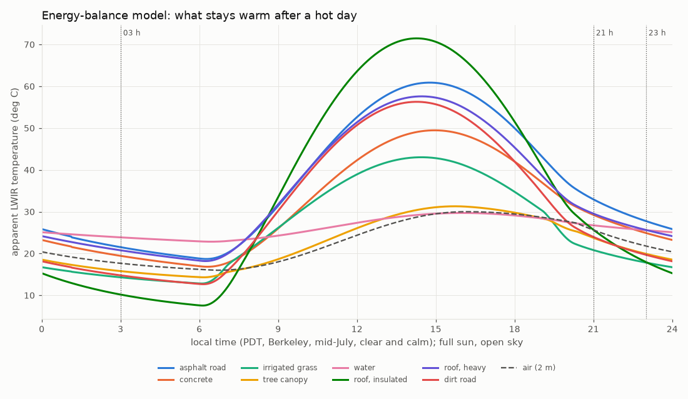
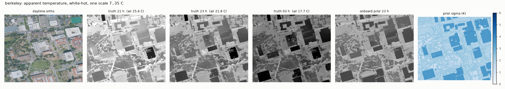
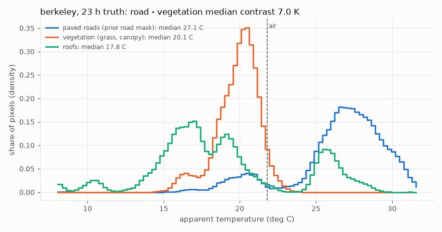
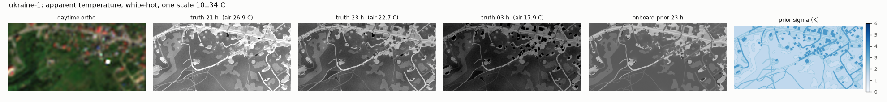
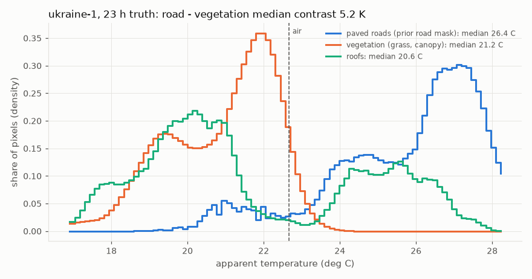

# Thermal world model and LWIR camera (`sfhack/thermal`)

Night scenario: a summer night after a hot day, clear sky, no wind. A downward thermal camera on the X2
(640 x 512, 50 deg HFOV, NETD 50 mK). Roads keep their heat and vegetation cools, so a map of *where the
warm surfaces are*, predicted from daytime data, can be matched against the live thermal image.

Built tonight (pre-hackathon work, branch `night-thermal`). Figures: `docs/figures/`.

```
uv run python -m sfhack.thermal build --mission berkeley [--hour 23] [--season summer] [--seed 0]
uv run python demos/20_thermal_view.py --mission berkeley          # fly the route: camera | ortho | prior
uv run python demos/21_thermal_figures.py                          # docs/figures/*
```

## Files (contract with night-nav / night-demo)

| File | Who reads it | Content |
| --- | --- | --- |
| `world/thermal_truth.npz` | **simulator only** (camera) | `temp_K` float32 (rows, cols): apparent temperature, roofs, canopy, cars, wet / shaded patches, HVAC included; `wall_K`, `air_K` (scalars); `cls` (truth material class); `cars` (json); `meta` (json) |
| `onboard/thermal_prior.npz` | the drone (`sfhack.thermal.prior.load_prior`) | `temp_K` predicted, `sigma_K` 1-std uncertainty, `cls` uint8 material class, `roads` uint8 (1 = paved highway visible from above), `road_kind` uint8 (0 none, 1 vehicle, 2 pedestrian, 3 parking), `roads_json` (OSM ways: highway, surface, material, width_m, paved (null = unknown), pts_enu), `meta` (json: bbox, extent_enu, res_m, rows, cols, class_names, hour, hour_solar, air_K, ...) |
| `drone/thermal_prior.npz` | the drone after a verified upload | copy of the prior (only when `drone/` exists) |
| `world/nir.png`, `onboard/nir.png` | model build | NIR band, 8-bit, ortho grid. New missions: written by missionprep (night-demo). Older NAIP missions: the thermal build fetches NAIP band 4 once and adds them. Missing = RGB greenness fallback |
| `world/thermal_build.json` | humans | build stats (cars, patches, prior-vs-truth error, seconds) |

Rasters: exactly the `ortho.jpg` grid: 0.5 m, north-up, row 0 = north, cell centre
`x = min_x + (col + 0.5) * 0.5`, `y = max_y - (row + 0.5) * 0.5` (docs/MAP_PACKAGE.md). Units: apparent
(radiometric, emissivity 1) LWIR temperature in kelvin, which is what a radiometric camera reports. Writes
are atomic (temp file + rename), so a rebuild never hands a flight a half-written file.

Onboard helper (prior only, no truth): `load_prior(onboard_dir).predict_view(pos_xy, agl_m, intrinsics, yaw=...)`
(or `R=` a camera-to-world rotation from the AHRS) returns the image the drone *expects* from that pose,
(temp_K, sigma_K) at half resolution, projected onto flat ground. It uses the same camera convention as the
simulated camera; `tests/test_thermal.py` checks the two agree (corr > 0.95 at three yaws). A matcher can
correlate the live frame against it directly, or against shifted / rotated versions of it.

Truth separation: `thermal/model.py` (makes the truth) and `thermal/camera.py` (renders it, imports MuJoCo)
are simulator side, like `world/scene.py`. `tests/test_truth_separation.py` checks that onboard code never
references `thermal_truth`, `thermal.model` / `thermal.camera`, `ThermalCamera`, `load_truth` or
`build_thermal`, and that `thermal/prior.py` imports nothing from the simulator.

## Pipeline

1. **Material class per 0.5 m pixel** (`classify.py`), later layers win:
   - spectral base: NDVI from NIR (> 0.12 = vegetation; without NIR, RGB excess green). Canopy vs lawn: a
     **LiDAR canopy height model** (> 2.5 m) from `onboard/map_cloud.ply` when it is real 3DEP LiDAR (NAIP crowns
     and lawns have the same NDVI and brightness; measured on Berkeley); otherwise an Otsu split of vegetation
     brightness plus OSM `natural=wood` / `landuse=forest` (tree) and meadow / grass / farmland (grass). Yellowish
     bright non-vegetation = dry grass; other non-vegetation: dark = asphalt, bright = concrete.
   - OSM areas: water, surface parking, artificial-turf pitches.
   - OSM highways buffered to a width per type (`lanes` and `width` tags used), material from `surface`
     (asphalt, concrete, pavers, dirt...), defaults per type. A road under a tree crown is hidden by the crown;
     a verge that the image shows as vegetation stays vegetation (not for Sentinel-2, whose 10 m pixels blur
     every narrow road into green).
   - outside the US, minor roads without a `surface` tag (Ukrainian village lanes) are **unknown**: the truth
     draws 40 % paved per way, the prior marks them dirt with raised sigma, `roads = 0`, `paved: null`.
   - OSM tree landmarks as crown discs, then building footprints as roofs (dark / light from the roof's
     brightness in the ortho), fountains as water.
2. **Sun exposure and sky view factor** per pixel (`shading.py`) from a 1 m DSM (truth: true terrain + true
   landmarks; prior: onboard `dsm.npz`): share of the day's direct beam that reached the pixel (shadow casting
   every 30 min, 5-20 h) and SVF from horizon angles in 16 directions. A road in a building's afternoon
   shadow stores less heat; a street canyon loses less heat to the sky at night.
3. **1-D surface energy balance** (`seb.py`) for every material x exposure {0, 0.5, 1} x SVF {0.3, 0.65, 1}
   (144 slabs at once, implicit conduction, 2 min steps, 5 days spin-up):
   `C dT/dt = (1-albedo)(exposure S_dir + svf S_diff) + eps L_in - eps sigma T^4 - h (T - T_air) - LE + G`,
   clear-sky solar (Meinel), sky emissivity from the dew point (Berdahl & Fromberg), `L_in` mixes sky and
   warm walls by SVF, convection `h = mult (2.5 + 1.7 dT^(1/3))` (calm night), latent heat as a fraction of
   the available energy (grass, canopy, water). Air: half-cosine day, Parton-Logan exponential night decay
   (summer: 30 C at 15 h, 16 C at 5:30). Output: apparent temperature, including the cold sky reflected by
   low-emissivity surfaces. Each pixel interpolates its class's table at the local solar time.
4. **Truth deviations** (what no map knows, so matching is not trivially perfect):
   roof construction per building (insulated membrane / light / heavy-ballasted / bare metal, conditioned on
   roof brightness; the prior only knows dark vs light), per-building offset 1 K, per-road-segment offset 1 K,
   per-class calibration error 0.5 K, irrigated vs dry lawn per patch (12 % flipped), sprinkler-wet patches
   on pavement (-3..-6 K), shade patches from unmapped street trees (-2..-4.5 K), rooftop HVAC units
   (+8..+20 K), **parked cars** along residential / service / tertiary streets and in parking lots (body ~2 K
   below air: roof and glass see the cold sky; 15 % recently driven with a hot hood), smooth model error
   (0.6 K, 20 m correlation), 0.25-0.4 K texture, and a low-frequency field: cold-air pooling (+1.4 K per
   100 m of terrain above the median: hills warmer than valleys on calm clear nights, seen in ASTER night scenes)
   plus a smooth +-0.5 K field over ~300 m. The prior also misses 5 % of minor OSM ways (incomplete OSM)
   and works from the degraded onboard ortho / NIR, perturbed landmarks and the onboard DSM.
5. **Prior sigma**: per-class sigma (asphalt 1.5 K ... roofs 3.5 K, bare metal 6 K), +1.5 K within 1 m of a
   class edge (misregistration), +2 K in deep ortho shadow or on roads of unknown surface, +0.6 K model error.

**Contrast knob.** night-research's check against real ASTER night scenes over Berkeley (90 m, 23:15 PDT, four
clear spring / autumn nights) found road-dense cells only +0.1..+0.7 K warmer at 90 m, which suggests 1-3 K pure
road contrast on *mild* nights, against 5-10 K after a hot summer day. `build_thermal(contrast=0.4)` /
`--contrast 0.4` scales the truth around the air temperature; `load_truth(mission, contrast=0.4)` does the same
at load time without rebuilding. The prior always stays on the model, as it would in reality. Use it for a
robustness row in the nav eval.

## Calibration (23:00 local, summer, clear, calm)

Apparent temperature minus 2 m air (air 21.8 C in Berkeley), full sun and open sky, compared with
night-research's `docs/NIGHT_NOTES_FOR_TEAM.md` (literature ranges):

| Material | Model | Literature (night-research) |
| --- | --- | --- |
| asphalt road | **+6.0 K** | +4..+8 |
| concrete | +3.1 | +3..+6 |
| irrigated grass | -4.0 | -5..-2 |
| tree canopy | -1.9 | -2..0 (warmer than lawn) |
| water | +3.8 | about the daily mean air (warm) |
| dirt / gravel road | +1.2 | -2..+2 |
| roof, insulated dark | -3.8 | -5..-3 |
| roof, insulated light (aged membrane) | -6.6 | -6..-4 typical (Khedari 2000: 1-6 K), -11 extreme |
| roof, heavy / ballasted | +3.8 | +2..+5 |
| roof, bare metal | -13.8 | very cold (low emissivity reflects the sky) |
| asphalt - grass | 9.9 K | 5-10 K (5.4 K measured at 22 h; 9.8 K night-research's own model) |
| asphalt cooling | 2.6 K/h until 22 h, then 1.5 K/h | ~2 K/h, then ~1.4 K/h |



Built missions (23:00, seed 0):

| Mission | Air | Road median | Vegetation median | Road - veg | Prior vs truth RMSE (corr) | Roads RMSE | Cars (hot) | Build |
| --- | --- | --- | --- | --- | --- | --- | --- | --- |
| berkeley (NAIP + LiDAR) | 21.8 C | 26.5 C | 19.9 C | 6.6 K | 3.95 K (0.62) | 2.97 K | 226 (32) | 22 s |
| m-c804bb84 (hill) | 21.8 C | 25.9 C | 19.4 C | 6.5 K | 3.07 K (0.75) | 2.50 K | 319 (40) | 28 s |
| ukraine-1 (Sentinel-2, GLO-30, no LiDAR) | 22.7 C | 27.9 C | 20.2 C | 7.7 K | 2.00 K (0.75) | 2.39 K | 484 (75) | 127 s |

Most of Berkeley's prior error is roofs (a third of the area; construction unknown to the prior). Prior
residuals are heavy-tailed, not Gaussian: 77-85 % of pixels are within 1 sigma (Gaussian 68 %), but only
86-96 % within 2 sigma (Gaussian 95 %), and on roads 89-92 %. Cars, HVAC units and roof-type swaps are
outliers, so **match robustly** (NCC on gradients, Huber, or sigma-weighted with outlier rejection).






## Camera (`camera.py`)

`ThermalCamera(model, name="thermal", renderer=None)`. The X2 carries a `thermal` camera on the down camera's
mount (image top = forward, right = right), fovy 40.9 deg = 50 deg HFOV at 640 x 512 (`CameraConfig.thermal_*`).
Ground sample distance 8.7 cm at 60 m, footprint 56 x 45 m.

Per frame: one GL pass gives depth **and** segmentation (MuJoCo's Renderer needs two) at 320 x 256 (or 300 x 240
inside the simulator's renderer); every pixel is back-projected to world xyz; ground, roof slabs and tree crowns
sample the truth raster (bilinear, softened by sigma 0.3 m so class edges are edges, not 0.5 m stair steps), walls get `wall_K` (air + 1.5 K, +-1 K per building), trunks ~air, objects
from `world/target_scene.json` their `temp_K` (default air - 1 K), the drone itself air, sky air - 30 K; a
world-fixed 0.25 m texture (0.2 K) breaks up the 0.5 m raster; air path tau = exp(-range / 8 km). Then upsample
to 640 x 512, optics blur (sigma 0.8 px), vignetting (-0.15 K at the corners), fixed-pattern noise (80 mK pixel,
40 mK column, 0.5 % gain), an absolute calibration error per camera (offset 2 K, gain 3 % (1 std): uncooled
radiometry is not absolute, so **match normalized images, not Kelvin**), slow drift (Ornstein-Uhlenbeck 0.25 K, tau 90 s, flat-field correction every 180 s),
temporal noise NETD 50 mK. `to_8bit`: linear AGC on the 1-99 % range (at least 4 K), smoothed over frames,
white-hot. `intrinsics`: {fx, fy, cx, cy, w, h, hfov_deg, vfov_deg}, pinhole, no distortion.

Speed (this laptop, while 3 other agents ran evals): 58-73 ms per frame (14-17 Hz) with its own GL context.
Interleaved with the simulator's down camera, a second GL context costs ~50 ms per switch on Windows (129 ms
per frame); pass `renderer=sim.renderer` to draw into the simulator's context (69 ms, same image within
0.01 K). Use that for flights.


## Limits and next steps

- Classes come from imagery + OSM + LiDAR; misclassification is real (unmapped buildings in the ortho become
  concrete in both truth and prior, because the simulated world has no building there either).
- The truth raster is 2.5-D: walls are one temperature per building, nothing under roofs or crowns.
- Weather is out of scope tonight: clouds (sky emissivity up, contrast down), wind (h up) and rain (thermal
  crossover) are each one parameter in `Climate` / `seb.py` and are untested.
- Hour is a parameter (`--hour`, local clock; solar time from the longitude with DST in summer); seasons
  other than summer are rough presets.
- Sentinel-2 (10 m) makes the off-road prior blurry. OSM geometry keeps the roads sharp, but untagged village
  lanes are a coin flip.
- Cars and wet patches are static per build (`--seed`), not per flight.

Sources: Oke, *Boundary Layer Climates*; Parton & Logan 1981 (air temperature model); Berdahl & Fromberg 1982
(clear-sky emissivity); Meinel 1976 (clear-sky beam); material properties: Hendel et al. 2016 and textbook
values; field ranges and roof numbers via night-research (Khedari et al. 2000; NIST; NRCA), see
`docs/NIGHT_RESEARCH.md` on branch night-research.
